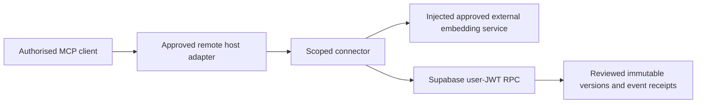

# Project-scoped MCP contracts

## What it does

Adds a transport-neutral MCP handler, guarded connector and Supabase RPC adapter for reviewed project-scoped learning. Nate B. Jones's OB1 remains the database and protocol foundation; legacy thoughts, vectors, queues and operators remain untouched.

This is an engineering package, with activation closed by default. It contains no model implementation, download, inference provider, local listener or credential loader. Existing Agent Memory API provides broader recall/write-back surfaces but calls OpenRouter and uses a shared MCP key; it is deliberately unchanged. This additive contract tests user-principal isolation and external embedding injection without silently redirecting that API.

## Prerequisites

- Node.js 22 or later for model-free library tests; no npm dependencies.
- Ephemeral PostgreSQL 17 with pgvector in the public schema for SQL tests.
- Separate owning approval before applying SQL, provisioning Auth/reviews, deploying a remote transport or activating an embedding host.
- A maintained external embedding interface with explicit host approval, model-space digest, 384 dimensions and no metered fallback. There is no workstation embedding runtime.

## Steps

1. Review `test/*.test.js` and `test/database.sql`, then run `npm test` and `npm run lint` in this directory. Tests use synthetic vectors only. They do not demonstrate semantic paraphrase quality.
2. In an isolated disposable database only, run `psql -X -v ON_ERROR_STOP=1 -f test/bootstrap.sql`, then `schema.sql`, then `test/database.sql`. The CI service is ephemeral and has no production credentials. Bootstrap is not a production script.
3. Review the exact additive SQL, grants, fixed search paths, explicit principal checks and model-space manifest. Before any real migration, verify extension schema, project, recovery evidence and owner approval. No schema is auto-applied.
4. Compose `createConnector` with trusted bound project/workstream, `space`, `store`, external `embedder` and a deterministic `enabled` function. The default returns a closed gate. The embedding response must include matching `spaceId`, `digest`, `receiptId` and finite non-zero `values`. Approval data is configuration evidence, not a substitute for host permission or network controls.
5. Compose `createSupabaseStore` with exact `projectRef`, supplied publishable key and an approved session supplier. It sends the user's JWT. Local token decoding rejects accidental privileged/expired tokens; Supabase verifies signatures and membership. No service-role key or shared MCP key is accepted as a user identity.
6. Supply the handler from `createMcpHandler` to a separately reviewed **remote** MCP transport. This package starts no Node server or stdio transport. Remote transport/authentication, approved Azure/AWS embedding capacity and native client configuration remain separate gates.

**Done when:** local/CI fixture checks pass and the owning reviewer accepts the source. Live acceptance additionally requires an actual approved source-backed capture, exact Supabase read-back, a genuine paraphrase, duplicate replay and two-principal isolation on the approved deployed route.

## Storage and security contract

`schema.sql` adds only `ob1_scoped_*` tables/functions and a dedicated private function schema. Authenticated members can read their project; direct writes are denied. Database-admin-reviewed source/content hashes bind a review to a project, workstream, knowledge identity and model space. The review table is an administrative input, not a self-approval tool.

Commit serialises scoped identity, rechecks the original principal and review inside a fixed-search-path privileged boundary, hashes the payload on the server, rejects conflicting events and stale current versions, then atomically stores content/vector/provenance, current pointer and receipt. Exact replay returns the original version without changing it. Prior versions remain available by authorised historical ID; current search excludes them. The old global fingerprint is not used.

New vectors live in a separate 384-dimensional space. Legacy 1,536-dimensional vectors are neither mixed nor re-embedded. Exact scoped scan is used for the small pilot, with project/workstream/space filtering before cosine ranking. The initial semantic coverage is only new approved records. No claim is made about legacy project mapping or bulk ingestion.

The separately approved embedding service must register a trusted vector receipt before capture can commit. The database compares the supplied vector, content hash, project/workstream and space with that protected receipt. MCP users cannot mint receipts or substitute an invented same-dimensional vector by asserting a model name. Service-side receipt registration/authentication remains an activation gate; tests seed receipts administratively with labelled synthetic vectors.

## Expected outcome

Model-free unit fixtures exercise denied scope, closed gate, missing review, source/hash mismatch, external embedding failure, wrong model digest/dimension, duplicate no-op, immutable supersession and read-back failures. SQL fixtures exercise genuine database grants/RLS and transaction behaviour in CI. Dependency-free tests need no model API or subscription key.

## Troubleshooting

- `GATE_CLOSED`: activation is intentionally absent. Obtain the owning runtime/migration/transport approval; do not add a paid fallback.
- `READBACK_FAILED`: stored content, scope, source or model manifest disagrees. Retain evidence and stop checkpoint advancement.
- `REVIEW_OR_MODEL_INVALID`: the server could not verify the administrative review/manifest. Do not rewrite metadata to bypass it.
- `PROJECT_FORBIDDEN`: check genuine Auth membership and the launcher's verified scope. A topic tag or UUID is not permission.
- Missing pgvector/Auth roles: use the ephemeral CI bootstrap for tests. Production prerequisites and extension schema must be verified separately.

## Rollback and remaining gates

Disable the new connector gate and approved remote registration only. Preserve additive tables, events and historical versions for recovery. No destructive rollback SQL is supplied, and legacy paid routes are not a fallback. Runtime hosting/cost approval, secure session lifecycle, remote MCP transport, live principal provisioning, backup/recovery, semantic quality and independent production review remain open.

Original OB1 provenance and licence remain in [LICENSE.md](../../LICENSE.md). Explore Nate's practical systems at [Nate's newsletter](https://substack.com/@natesnewsletter) and [natebjones.com](https://natebjones.com).
